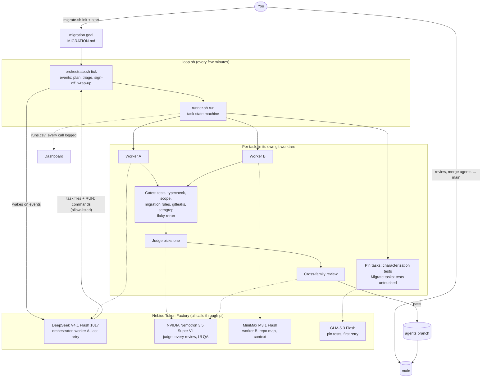

# Nemotron Migration Agent

**A legacy code migration agent that proves it didn't break anything.** Point it at an old codebase: it pins
the current behaviour with tests, plans the migration in safe steps, has open models on Nebius Token
Factory make the edits, and nothing merges until the tests stay green and **NVIDIA Nemotron**, a model family
no worker uses, has judged and reviewed the change. A human always makes the final merge.

Built for the Nebius x NVIDIA hackathon (track: Coding and Agentic Engineering). Every model call runs on
Nebius Token Factory; nothing depends on a local model router or a paid chat subscription.

> Status: hackathon build. The demo migrated an Express 4 REST API to Fastify 5 + TypeScript +
> async/await end to end: [see the result](#see-the-result). Roadmap [below](#roadmap).

## Why

Migrations (framework swaps, JavaScript to TypeScript, callbacks to async/await, API version bumps) are the work teams put off
because the risk is silent breakage. AI coding agents make the edits fast, but you still have to trust
them. This agent is built around proof instead of trust:

- **Behaviour is pinned first.** Characterization tests capture what the old code does, and they must pass
  before any change is made.
- **Every change has to keep them green**, plus lint, typecheck, build, a scope check and a security scan.
- **Models check each other.** Two workers from different model families compete on each task, and the
  judge and reviewers are Nemotron, a family no worker uses, so no model grades its own family's work.
- **The planner only decides.** The orchestrator is woken only when a decision is waiting (plan a goal,
  triage a stuck task, sign off a risky change), not to poll or write code.
- **Models chosen by measured intelligence per dollar**, not by brand: four models from four families, picked
  from the Artificial Analysis Intelligence Index v5 and Token Factory prices (see below).
- **A human merges.** Agents merge into an `agents` branch; only you merge `agents` into `main`.

## Quick start

**1. Install** (macOS, about 2 minutes)

```bash
git clone https://github.com/abomasumm/nemotron-migration-agent && cd nemotron-migration-agent
brew bundle                                             # git, python, node, jq, coreutils, gitleaks, semgrep, gh
npm install -g @earendil-works/pi-coding-agent@1.0.4    # pi: runs the models
```

<details><summary>Linux</summary>

```bash
sudo apt install -y git python3 nodejs npm jq curl coreutils
npm install -g @earendil-works/pi-coding-agent@1.0.4
pipx install semgrep   # optional; gitleaks: https://github.com/gitleaks/gitleaks/releases
```
</details>

**2. Get an API key** from [Nebius Token Factory](https://tokenfactory.nebius.com). You'll paste it into the app.

**3. Start the app**

```bash
python3 app/server.py     # open http://127.0.0.1:8780
```

It checks your tools on start and shows the install command for anything missing.

**4. Migrate**

1. **Add a repo:** a GitHub URL or a local git repo. Its tests must pass today.
2. **Providers:** paste your Token Factory key into the `tokenfactory` provider and choose its models
   (scores and prices are shown).
3. **Questions:** the agent analyses the repo (stack, commands, modules, test coverage, import order) and
   shows 10 migration questions with suggested answers. Answer them, then review `MIGRATION.md`.
4. **Models:** keep the defaults or pick a model per role. The app enforces cross-family review: the reviewer
   is a family no worker uses, and the two workers differ.
5. **Start**, then watch the **Dashboard**: modules pinned and migrated, tasks, gate results, verdicts,
   diffs, and buttons to approve, reject, requeue with a hint, or pause.
6. **Get the result:** *Open pull request* (needs a GitHub remote and `gh auth login`), or `git switch agents`
   in your repo and merge it yourself.

**Try it on the demo first:** copy [`examples/legacy-bookstore-api`](examples/legacy-bookstore-api) somewhere,
`git init` it and commit, then add that folder in the app. [See the result](#see-the-result) for what you
should end up with.

### If something goes wrong

| Problem | Fix |
| --- | --- |
| "baseline tests fail" | Fix the repo's tests first: the migration is proven against them |
| No suggested answers in Questions | Add your key in Providers, then "Analyse again" |
| "Open pull request" says no GitHub remote | `git remote add origin <url> && git push -u origin main`, or merge `agents` yourself |
| CommonJS project warning | Add `NODE_OPTIONS='--import tsx'` to the test script (the warning explains why) |

The app listens on 127.0.0.1 only, and every API call needs a random token embedded in the page, so other
sites open in your browser can't drive it. It is a thin layer over the scripts in `.agents/`: everything it
does can also be done from the terminal (see [Without the app](#without-the-app)).

## See the result

[`examples/legacy-bookstore-api`](examples/legacy-bookstore-api) is the demo input: a bookstore REST API on
Express 4 in callback-style CommonJS (books with filtering and paging, orders with tax, a bulk discount and
stock reservation, API-key auth, hand-written validation, one error format). Only `GET /books` had tests.

[`examples/legacy-bookstore-api-migrated`](examples/legacy-bookstore-api-migrated) is the same app after one
run of the agent: **Fastify 5 + TypeScript (strict) + async/await**. Open the two folders side by side.

| | Before | After |
| --- | --- | --- |
| Framework | Express 4 | Fastify 5 |
| Language | CommonJS JavaScript, callbacks | Strict TypeScript, ES modules, async/await |
| Tests | 5 | 100 (95 characterization tests pinned first; the original 5 untouched) |
| Typecheck | n/a | clean |

The run took 11 tasks, 37 model calls and about 34 minutes. The agent pinned behaviour with 7 pin tasks,
converted `errors`, `validate` and `store` one at a time, then switched Express to Fastify in one high-risk
task with two competing workers, two Nemotron reviews and a sign-off. Along the way the scope gate rejected a
worker's symlink workaround and the security scan rejected one of the two Fastify versions. When it closed
the migration, the orchestrator noted that `package.json` (out of scope) still lists Express, for a human to
clean up.

A smaller example, [`examples/legacy-invoice-js`](examples/legacy-invoice-js), is a plain JavaScript library
to migrate to TypeScript.

## Architecture



### How a goal moves through the pipeline

1. **Describe.** `migrate.sh init` reads the repo, checks the tests pass, and asks 10 questions; the
   answers become `MIGRATION.md`. `migrate.sh start` queues the goal.
2. **Context.** MiniMax packs the relevant context from the repo map.
3. **Plan.** The orchestrator (DeepSeek) splits the goal into pin tasks, then migrate tasks in dependency
   order, each with the files its worker may touch.
4. **Build.** Per task, in its own worktree: pin tasks get characterization tests from GLM; migrate tasks
   get two workers from different families (DeepSeek and MiniMax) in parallel.
5. **Gate.** Tests, typecheck, a scope check, the migration rules (pin tasks only add tests, migrate tasks
   never touch them) and a security scan (gitleaks, semgrep). Failures are rerun once to catch flaky tests.
6. **Judge and review.** Nemotron picks the better passing attempt and reviews it; risky and long tasks get
   a second, senior Nemotron review.
7. **Retry or triage.** A failed task climbs a retry ladder (another family, then DeepSeek at max effort).
   If the ladder runs out, the orchestrator re-briefs, splits, escalates or parks it for you.
8. **Merge.** Passing work merges into `agents`; risk: high tasks wait for sign-off first. When every task
   is in, a batch review runs and the orchestrator closes the milestone. You merge `agents` into `main`.

### Which model does what

Picked from the [Artificial Analysis](https://artificialanalysis.ai/leaderboards/models) Intelligence Index
v5 and [Token Factory prices](https://tokenfactory.nebius.com/model-catalog.md) (October 2026): the most
intelligence per dollar, from four different families.

| Role | Model on Token Factory | Index v5 | Cost per AA task | $ per 1M in / out |
| --- | --- | --- | --- | --- |
| Judge, every review, UI screenshot QA | `nvidia/Nemotron-3.5-Super-VL` | 14 | $0.56 | 0.30 / 0.90 |
| Orchestrator, worker A, last retry (max effort) | `deepseek-ai/DeepSeek-V4.1-Flash-1017` | 32 | $0.60 | 0.30 / 1.20 |
| Worker B, repo map, context packs, setup suggestions | `MiniMaxAI/MiniMax-M3.1-Flash` | 29 | $0.49 | 0.15 / 0.60 |
| Pin tests, first retry | `zai-org/GLM-5.3-Flash` | 28 | $0.58 | 0.15 / 0.50 |

**Why one Nemotron model, and why as the reviewer.** Nemotron 3.5 Super VL is both the highest-scoring
Nemotron on Token Factory (14, vs 12 for Nemotron 3 Ultra) and about 4x cheaper per task than Ultra, and it
reads screenshots. It is the judge and reviewer because it is a family no worker uses: no model ever grades
its own family's work. Planning, the most intelligence-sensitive role, goes to the highest-scoring model
per dollar, DeepSeek V4.1 Flash 1017.

All of this lives in [`.agents/routing.sh`](.agents/routing.sh); swap a model per repo in `.agents/local.sh`.
Any OpenAI-compatible endpoint can be added as another provider in
[`.agents/pi/models.json`](.agents/pi/models.json).

### Design notes

- **One dispatcher.** Every model call goes through `run_model` in [`.agents/lib.sh`](.agents/lib.sh): it
  runs [pi](https://pi.dev) in print mode with a pinned tool list, logs the call to `runs.csv`, and walks a
  fallback chain when Token Factory rate-limits a model.
- **Isolated from your machine.** pi runs with the repo's own config directory (`.agents/pi/`) and with MCP,
  extensions, skills and context-file discovery switched off, so pipeline runs never pick up your personal
  setup.
- **The orchestrator has no shell.** It gets read and edit tools only. It lists the kit commands it
  wants (`RUN: .agents/runner.sh requeue T-004 "hint"`) and `orchestrate.sh` runs only allow-listed ones,
  without a shell. Edits it makes outside task files and `NOTES.md` are undone.
- **State is plain files.** Goals and tasks are Markdown files with frontmatter; every call is a row in
  `.agents/logs/runs.csv`. The dashboard reads these directly.

## Without the app

The same flow from the terminal, inside the repo you want to migrate:

```bash
bash ~/path/to/nemotron-migration-agent/setup.sh .   # install the agent (never copies your keys)
echo 'export NEBIUS_API_KEY="..."' > .agents/secrets.sh   # git-ignored
.agents/doctor.sh --models                           # tools, key, models (a few credits)
git add .agents AGENTS.md NOTES.md .gitignore && git commit -m "migration agent"
.agents/migrate.sh init                              # analyse, ask the 10 questions, write MIGRATION.md
git add MIGRATION.md && git commit -m "migration plan"
.agents/migrate.sh start                             # queue the goal
tmux new -s agents '.agents/loop.sh'                 # run the pipeline
python3 .agents/dashboard.py                         # read-only dashboard at http://127.0.0.1:8765
```

Test, lint, typecheck and build commands are detected for Node and Python projects; edit
`.agents/gates/check.sh` for anything else. `migrate.sh init --template` writes `MIGRATION.md` without
questions, for you to fill in. `dashboard.py --export site/` writes a static snapshot you can host anywhere.

## How migration mode works

`MIGRATION.md` (written by `migrate.sh init`) is the contract: every worker and the planner read it. For a
goal started with `migrate.sh start`, the orchestrator plans two kinds of task:

| Task type | What the worker does | What the `migration.sh` gate enforces |
| --- | --- | --- |
| `pin` | Writes characterization tests for a module that has none, pinning what it does today, odd results included | Only test files change, at least one is added; the full suite passes on the unchanged source |
| `migrate` | Converts one module, leaves first in import order, without changing behaviour | No test file is edited or deleted; every test (old and pinned) still passes, plus typecheck |

Migrate tasks depend on every pin task and on the modules they import, so nothing is converted before its
behaviour is pinned. Each migrate task gets two competing workers from different families, a Nemotron judge
and review, and critical modules get a senior Nemotron review and the orchestrator's sign-off. When a
framework is swapped (Express to Fastify), framework-independent modules go first, one per task, and the
modules wired through the framework switch together in one task, so nothing has to run half-migrated.

**Flaky tests:** gates are deterministic except tests. When gates fail, they are rerun on the same code
(`FLAKY_RERUNS`, default 2). A pass on rerun means a test is flaky: the attempt passes with a warning instead
of failing the worker, the dashboard flags it, and MiniMax writes a short diagnosis
(`.agents/tasks/T-012.flaky.md`).

## Commands

| Command | What it does |
| --- | --- |
| `migrate.sh init [--template]` | Detect the repo, ask the questions, write `MIGRATION.md` and a brief |
| `migrate.sh start [profile]` | Queue the migration goal |
| `migrate.sh status` | Modules pinned and migrated so far |
| `dashboard.py [--port N]` / `--export DIR` | Live dashboard, or a static snapshot |
| `orchestrate.sh goal "brief" [profile] [migration]` | Queue any goal; the orchestrator plans it on the next tick |
| `orchestrate.sh goals` | Goal progress: `new → packed → planned → wrapup → done` |
| `orchestrate.sh brief` | Print what the orchestrator would be given (free) |
| `orchestrate.sh wake` | Wake the orchestrator now (still respects the daily cap) |
| `runner.sh status` | Every task: `queued → building → gating → reviewing → merged` |
| `runner.sh show T-012` | Digest of one task: brief, log, verdicts, last failure, gates, diffstat |
| `runner.sh approve` / `reject T-012 "why"` | Sign off a risk: high task yourself |
| `runner.sh requeue T-012 "hint"` | Run a task again with a hint |
| `runner.sh task T-012` | Run one task in the foreground (debugging) |
| `stats.sh [days]` | Calls, errors, gate pass rate and best-of-2 wins per model |
| `doctor.sh [--models]` | Check the setup |

Profiles: `default` (best-of-2 on features, senior review on risky work), `risky` (every task treated as
high risk, sign-off on everything; use for migrations of core modules) and `fast` (one worker, no judge,
three tasks in parallel). Set per run with `PROFILE=risky`, per goal as the second argument to `goal`, or
per task with `profile:` in its frontmatter.

Where to look: `.agents/logs/runs.csv` (every model call), `.agents/logs/orchestrator.log` (every wake and
the commands it ran), `.agents/tasks/T-012.md` (the task and its log), `.agents/tasks/T-012.gates.log`.

## Roadmap

Deadline: Oct 31, 2026, 01:00 GMT (Devpost).

### Done

- [x] Every model call on Nebius Token Factory through pi; 9router, Oh My Pi, the Claude CLI and the
      subscription plan caps removed
- [x] Models chosen by intelligence per dollar (Artificial Analysis v5, Token Factory prices): one Nemotron
      (3.5 Super VL) as judge and reviewer; DeepSeek V4.1 Flash 1017, MiniMax M3.1 Flash and GLM-5.3 Flash
- [x] Repo-local pi config (`.agents/pi/models.json`), isolated from the user's own pi setup
- [x] Orchestrator without a shell: allow-listed `RUN:` commands, out-of-scope edits undone (tested
      against injection attempts)
- [x] API key in a git-ignored `secrets.sh` that `setup.sh` never copies
- [x] `doctor.sh` checks the key, that every model is offered by Token Factory and visible to pi;
      `--models` smoke test passes for every configured model
- [x] Retry ladder, rate-limit fallbacks and daily caps rebuilt for Token Factory models
- [x] Demo app (`examples/legacy-bookstore-api`): Express 4 REST API, callbacks, CommonJS, one tested endpoint
- [x] `migrate.sh init`: detects stack, commands, modules, test coverage and import order; checks the
      baseline is green; MiniMax suggests answers; asks 10 questions; writes `MIGRATION.md` and a brief
- [x] Migration mode: `pin` and `migrate` task types, the `migration.sh` gate, a migration planning prompt
- [x] Flaky-test check: rerun failed gates, flag instead of failing, diagnosis by the helper model
- [x] Dashboard: live server and static export
- [x] Web app (local): add a repo by GitHub URL or path, questionnaire form, providers with keys, model per
      role with the family rule enforced, start, dashboard with actions, open a pull request
- [x] Model roles in `.agents/config.json` and a model catalog with scores and prices, so the app can change
      models without touching the scripts
- [x] Architecture page updated to the built design
- [x] Full run: the bookstore API migrated from Express 4 to Fastify 5 + TypeScript end to end
      ([result](examples/legacy-bookstore-api-migrated))

### Next, for the submission

- [ ] **Release:** LICENSE (MIT), `gitleaks detect` over the history, make the repo public
- [ ] **Submission:** demo video under 3 minutes, Devpost description, Token Factory and NVIDIA feedback,
      "what changed during the hackathon" write-up

### After the hackathon

- [ ] Run on GitHub instead of hosting anything: a GitHub Action runs the pipeline on GitHub's runners
      (isolated, nothing to host), an Issue Form is the migration questionnaire, repository secrets hold the
      API keys, workflow inputs pick the model per role, and the Action opens the pull request. The local
      app stays as the single-machine option.
- [ ] Optional services instead of custom code: OpenRouter or LiteLLM for many providers, budgets and
      fallbacks; Langfuse or Helicone for tracing model calls
- [ ] Deterministic codemods first (ts-migrate, OpenRewrite) for the mechanical part, models for the rest
- [ ] Harness adapters, so each role can use a different harness (pi today; Codex and others later)
- [ ] Run gates as Nebius Serverless Jobs instead of on the local machine
- [ ] More migration recipes (framework upgrades, API version bumps, Python 2 to 3)

## What changed during the hackathon

This project started as `agent-pipeline-kit`, a general feature-building pipeline that used Claude Opus as
the orchestrator and cheap models through a local router. During the hackathon it was rebuilt to run
entirely on Nebius Token Factory, with models chosen by intelligence per dollar and NVIDIA Nemotron as
the judge and reviewer of every change; the orchestrator was moved off
the Claude CLI onto a shell-less, allow-listed design, and it became a migration agent: `migrate.sh init`
(repo detection plus a short questionnaire that writes `MIGRATION.md`), characterization (`pin`) and
`migrate` tasks with a gate that keeps tests untouched and green, a flaky-test check, a dashboard, and a
local web app that takes a repo from URL to pull request.

## Repo layout

```
Brewfile                 macOS dependencies: brew bundle
setup.sh                 install or update the agent in a target repo
app/                     local web app: server.py (standard library only) and index.html
.agents/
  routing.sh             every model and routing decision
  lib.sh                 dispatcher (run_model), task-file helpers, caps
  orchestrate.sh         goals, events, orchestrator wakes, RUN: allow-list
  runner.sh              task state machine: tests, workers, gates, judge, review, merge
  cos.sh                 helper jobs: repo map, context pack, status note
  loop.sh                runs the scheduler and the orchestrator tick every few minutes
  migrate.sh, detect.py  migration setup: repo detection, questions, MIGRATION.md, start
  dashboard.py/.html     read-only dashboard (live or static export)
  doctor.sh, stats.sh    setup check; per-model results from runs.csv
  gates/                 check.sh (tests/lint/types/build), scope.sh, migration.sh, security.sh, UI example
  prompts/               one prompt per role
  pi/models.json         providers and models for pi (repo-owned: the app edits it)
  catalog.json           known models (family, intelligence score, price) and the fixed roles
  config.json            model per role, written by the app (optional)
  secrets.sh.example     copy to secrets.sh and add your key
examples/                legacy-bookstore-api (demo input), legacy-bookstore-api-migrated (its result),
                         legacy-invoice-js (smaller JS → TS example)
docs/                    architecture pages
```
