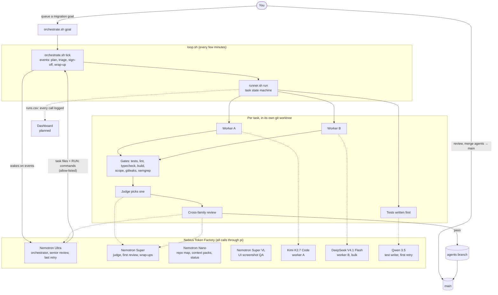

# Nemotron Migration Agent

**A legacy code migration agent that proves it didn't break anything.** Point it at an old codebase: it pins
the current behaviour with tests, NVIDIA Nemotron Ultra plans the migration module by module, open models
on Nebius Token Factory make the edits, and nothing merges until the tests stay green and a model from a
different family signs off. A human always makes the final merge.

Built for the Nebius x NVIDIA hackathon (track: Coding and Agentic Engineering). Every model call runs on
Nebius Token Factory; nothing depends on a local model router or a
paid chat subscription.

> Status: work in progress. The pipeline runs end to end on Token Factory; migration mode and the
> dashboard are being built. See the [roadmap](#roadmap).

## Why

Migrations (JavaScript to TypeScript, framework upgrades, API version bumps) are the work teams put off
because the risk is silent breakage. AI coding agents make the edits fast, but you still have to trust
them. This agent is built around proof instead of trust:

- **Behaviour is pinned first.** Characterization tests capture what the old code does, and they must pass
  before any change is made.
- **Every change has to keep them green**, plus lint, typecheck, build, a scope check and a security scan.
- **Models check each other.** Two workers from different model families compete on each task, and the
  judge and reviewers are Nemotron, a family no worker uses, so no model grades its own family's work.
- **The expensive model only decides.** Nemotron Ultra is woken only when a decision is waiting (plan a
  goal, triage a stuck task, sign off a risky change), not to poll or write code.
- **A human merges.** Agents merge into an `agents` branch; only you merge `agents` into `main`.

## Architecture



### How a goal moves through the pipeline

1. **Queue.** You write a short brief (3 to 6 testable acceptance criteria) and run `orchestrate.sh goal`.
2. **Context.** Nemotron Nano packs the relevant context from the repo map.
3. **Plan.** Nemotron Ultra splits the goal into small tasks (one reviewable change each, with the files
   each worker may touch) and writes them as task files.
4. **Build.** Per task, in its own worktree: a third-family model writes tests first; two workers from
   different families implement it in parallel.
5. **Gate.** Tests, lint, typecheck, build, a scope check (workers may only touch listed files) and a
   security scan (gitleaks, semgrep) run on each attempt.
6. **Judge and review.** Nemotron Super picks the better passing attempt and reviews it; risky and long
   tasks also get a senior review from Nemotron Ultra.
7. **Retry or triage.** A failed task climbs a retry ladder (another family, then Ultra). If the ladder runs
   out, Ultra re-briefs, splits, escalates or parks it for you.
8. **Merge.** Passing work merges into `agents`; risk: high tasks wait for sign-off first. When every task
   is in, a batch review runs and Ultra closes the milestone. You merge `agents` into `main`.

### Which model does what

| Role | Model on Token Factory | Why |
| --- | --- | --- |
| Orchestrator, senior review, last retry | `nvidia/Nemotron-3-Ultra-550b-a55b` | Strongest reasoning, used only for decisions |
| Judge, first review, milestone wrap-up | `nvidia/nemotron-3-super-120b-a12b` | Cheaper Nemotron; a family no worker uses |
| Repo map, context packs, status notes | `nvidia/NVIDIA-Nemotron-3-Nano-30B-A3B` | Fast and cheap for summarising |
| UI screenshot QA | `nvidia/Nemotron-3.5-Super-VL` | Vision |
| Worker A | `moonshotai/Kimi-K2.7-Code` | Coding model |
| Worker B, bulk edits | `deepseek-ai/DeepSeek-V4.1-Flash` | Second family for best-of-2 |
| Test writer, first retry | `Qwen/Qwen3.5-397B-A17B` | Third family, so tests aren't written by the worker's family |

All of this lives in [`.agents/routing.sh`](.agents/routing.sh); swap a model per repo in `.agents/local.sh`.
Any OpenAI-compatible endpoint can be added as another provider in
[`.agents/pi/models.json`](.agents/pi/models.json).

### Design notes

- **One dispatcher.** Every model call goes through `run_model` in [`.agents/lib.sh`](.agents/lib.sh): it
  runs [pi](https://pi.dev) in print mode with a pinned tool list, logs the call to `runs.csv`, and walks a
  fallback chain when Token Factory rate-limits a model.
- **Isolated from your machine.** pi runs with the repo's own config directory (`.agents/pi/`) and with MCP,
  extensions, skills and context-file discovery switched off, so pipeline runs never pick up your personal
  setup.
- **The orchestrator has no shell.** Ultra gets read and edit tools only. It lists the kit commands it
  wants (`RUN: .agents/runner.sh requeue T-004 "hint"`) and `orchestrate.sh` runs only allow-listed ones,
  without a shell. Edits it makes outside task files and `NOTES.md` are undone.
- **State is plain files.** Goals and tasks are Markdown files with frontmatter; every call is a row in
  `.agents/logs/runs.csv`. The dashboard will read these directly.

## Setup

Requirements: macOS or Linux, git, bash 4+, `timeout` (macOS: `brew install coreutils`), jq, curl,
python3, [pi](https://pi.dev), and a Nebius Token Factory API key. gitleaks and semgrep are optional
(their gate is skipped without them).

```bash
brew install bash coreutils jq gitleaks semgrep tmux
```

1. **Install the agent into the repo you want to migrate:**
   ```bash
   bash setup.sh ~/code/my-legacy-repo
   cd ~/code/my-legacy-repo
   ```
2. **Add your key** to `.agents/secrets.sh` (git ignores it; `setup.sh` never copies it):
   ```bash
   export NEBIUS_API_KEY="..."
   ```
3. **Tell it about the repo.** Edit `.agents/gates/check.sh` for the repo's test, lint, typecheck and build
   commands (Node and Python are detected automatically), and fill in `AGENTS.md`.
4. **Check everything:**
   ```bash
   .agents/doctor.sh            # tools, key, every model offered by Token Factory, pi config
   .agents/doctor.sh --models   # every model replies "ready" (uses a few credits)
   ```
5. **Commit the kit, then map the repo:**
   ```bash
   git add .agents AGENTS.md NOTES.md .gitignore && git commit -m "agent pipeline"
   .agents/cos.sh map           # Nemotron Nano writes REPO_MAP.md
   ```
6. **Start the loop and queue a goal:**
   ```bash
   tmux new -s agents 'caffeinate -is .agents/loop.sh'
   .agents/orchestrate.sh goal "$(cat brief.md)"
   ```

## Usage

| Command | What it does |
| --- | --- |
| `orchestrate.sh goal "brief" [profile]` | Queue a milestone goal; Ultra plans it on the next tick |
| `orchestrate.sh goals` | Goal progress: `new → packed → planned → wrapup → done` |
| `orchestrate.sh brief` | Print what the orchestrator would be given (free) |
| `orchestrate.sh wake` | Wake the orchestrator now (still respects the daily cap) |
| `runner.sh status` | Every task: `queued → building → gating → reviewing → merged` |
| `runner.sh show T-012` | Digest of one task: brief, log, verdicts, last failure, gates, diffstat |
| `runner.sh approve` / `reject T-012 "why"` | Sign off a risk: high task yourself |
| `runner.sh requeue T-012 "hint"` | Run a task again with a hint |
| `runner.sh task T-012` | Run one task in the foreground (debugging) |
| `stats.sh [days]` | Calls, errors, gate pass rate and best-of-2 wins per model |
| `doctor.sh [--models]` | Check the setup |

Profiles: `default` (best-of-2 on features, senior review on risky work), `risky` (every task treated as
high risk, sign-off on everything; use for migrations of core modules) and `fast` (one worker, no judge,
three tasks in parallel). Set per run with `PROFILE=risky`, per goal as the second argument to `goal`, or
per task with `profile:` in its frontmatter.

Where to look: `.agents/logs/runs.csv` (every model call), `.agents/logs/orchestrator.log` (every wake and
the commands it ran), `.agents/tasks/T-012.md` (the task and its log), `.agents/tasks/T-012.gates.log`.

## Roadmap

Deadline: Oct 31, 2026, 01:00 GMT (Devpost).

### Done

- [x] Every model call on Nebius Token Factory through pi; 9router, Oh My Pi, the Claude CLI and the
      subscription plan caps removed
- [x] Nemotron Ultra as orchestrator, Super as judge and reviewer, Nano for maps and context, Super VL for
      UI QA; Kimi, DeepSeek and Qwen as the three worker and test-writer families
- [x] Repo-local pi config (`.agents/pi/models.json`), isolated from the user's own pi setup
- [x] Orchestrator without a shell: allow-listed `RUN:` commands, out-of-scope edits undone (tested
      against injection attempts)
- [x] API key in a git-ignored `secrets.sh` that `setup.sh` never copies
- [x] `doctor.sh` checks the key, that every model is offered by Token Factory and visible to pi;
      `--models` smoke test passes for all 7 models
- [x] Both worker models verified editing files through the dispatcher
- [x] Retry ladder, rate-limit fallbacks and daily caps rebuilt for Token Factory models

### Next, for the submission

- [ ] **Demo repo:** a small real-world JavaScript project to migrate to TypeScript
- [ ] **First real run:** Ultra plans a goal on the demo repo and one milestone merges into `agents`
- [ ] **Migration mode:**
  - [ ] Characterization tests that must *pass* on the old code (today's rule is "new tests must fail on
        the old code", which suits features, not migrations)
  - [ ] A migration planner prompt: one task per module, in dependency order
  - [ ] A keep-green gate: the pinned tests plus typecheck must pass after every change
- [ ] **Flaky-test check:** rerun a failing test a few times; mark it flaky instead of failing the worker,
      and Nano writes a short diagnosis
- [ ] **Dashboard:** goal progress, task board, tests going red to green, diffs, which model made each
      decision, calls per Nemotron tier (read-only, from task files and `runs.csv`)
- [ ] **Release:** LICENSE (MIT), `gitleaks detect` over the history, make the repo public
- [ ] **Docs:** update `docs/architecture_hackathon.html` to the pi-only design
- [ ] **Submission:** demo video under 3 minutes, Devpost description, Token Factory and NVIDIA feedback,
      "what changed during the hackathon" write-up

### After the hackathon

- [ ] Turn the dashboard into an app: a small API server over the state files, with actions (queue a goal,
      approve, merge) and a settings screen for providers, keys and the model per role
- [ ] Harness adapters, so each role can use a different harness (pi today; Codex and others later)
- [ ] Run gates as Nebius Serverless Jobs instead of on the local machine
- [ ] More migration recipes (framework upgrades, API version bumps, Python 2 to 3)

## What changed during the hackathon

This project started as `agent-pipeline-kit`, a general feature-building pipeline that used Claude Opus as
the orchestrator and cheap models through a local router. During the hackathon it was rebuilt to run
entirely on Nebius Token Factory with NVIDIA Nemotron making every decision, the orchestrator was moved off
the Claude CLI onto a shell-less, allow-listed design, and it is being turned into a migration agent with
characterization tests and a dashboard. See the roadmap above for what is done.

## Repo layout

```
setup.sh                 install or update the agent in a target repo
.agents/
  routing.sh             every model and routing decision
  lib.sh                 dispatcher (run_model), task-file helpers, caps
  orchestrate.sh         goals, events, orchestrator wakes, RUN: allow-list
  runner.sh              task state machine: tests, workers, gates, judge, review, merge
  cos.sh                 Nano helper jobs: repo map, context pack, status note
  loop.sh                runs the scheduler and the orchestrator tick every few minutes
  doctor.sh, stats.sh    setup check; per-model results from runs.csv
  gates/                 check.sh (tests/lint/types/build), scope.sh, security.sh, UI check example
  prompts/               one prompt per role
  pi/models.json         Token Factory provider for pi
  secrets.sh.example     copy to secrets.sh and add your key
docs/                    architecture pages
```
